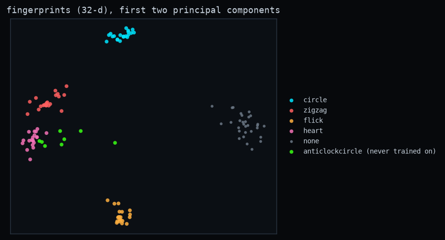

# Larp Charm

**A wearable bag charm with a touchscreen, a Web Bluetooth control app that looks and works like a terminal, a pocket remote for Claude Code, and on-device machine learning: draw spells in the air and the charm recognises them.**

Larp Charm runs on a Waveshare ESP32-S3-Touch-LCD-1.69 (240×280 IPS, capacitive touch, 6-axis IMU, buzzer, LiPo). The firmware is a small single-sketch "OS" with a cyberdeck interface and a dozen apps. The companion web app pairs over Bluetooth LE: no install, no backend, no native app. It also runs a live copy of the charm's screen in the page, which follows the real charm while it's connected: it switches screens with it, shows the weather, pet, message and ID card the charm has kept, and the cover going full screen.

**Live web app: [anando-99.github.io/larpcharm](https://anando-99.github.io/larpcharm/)**


## Highlights

- **Spells: air-gesture recognition, on the charm.** Draw a circle, zigzag, flick or heart in the air and the charm recognises it, plays an effect and does something (torch, new colour, next song, eyes in love, or whatever you choose in the spellbook). A 1D CNN of 38,848 parameters, trained on accelerometer + gyro takes recorded with the charm itself, runs on the ESP32-S3 in 69 ms and turns a gesture into a 32-number fingerprint. **Teach it your own** gestures by drawing them 5 times: it learns them on the spot, with no retraining, using DTW on your recordings with the network able to veto. It is also a **wand**: twist it like a knob to set the volume, draw in the air and see the sketch on the screen (and on the website), cast big to overcharge a spell, and watch your gesture's fingerprint land on a live 2D map of the network's fingerprint space. Cross-validated: the built-in spells are 100% right with 96.7% of "not a spell" rejected, and new gestures are recognised 91.9% of the time with 0.2% false matches. The C engine and the website's JS port both match PyTorch to about 1e-7. **The full story, with figures: [docs/spells.md](docs/spells.md).**

  

- **A remote for Claude Code.** `larp-bridge` (a dependency-free Node script) plugs into Claude Code's hooks and status line. The charm's `cc` screen then mirrors your real session on the laptop: the live transcript with tool calls and results, the spinner with Claude's actual state, and a `/status`-style page with model, context, cost, time and lines changed. When Claude needs permission, the charm buzzes and shows an **approve / deny** card, and your tap answers Claude on the laptop. A launcher page starts preset sessions in Terminal. The mascot reacts to all of it. It is fail-safe by design: if the bridge or the charm isn't there, Claude Code behaves exactly as normal, and unanswered prompts fall back to the terminal after 45 s.
- **A control panel that is a terminal.** The web app is styled like a tmux session (panes, `0:claude 1:look …` windows, `[ buttons ]`, `--flags`), with a real command line pinned to the bottom: `open claude`, `theme phosphor`, `msg ship it`, `timer 25`, `allow`, `launch 2`, `status`, with history and tab completion.
- **Custom BLE protocol.** A Nordic-UART-style GATT service with 23 binary commands, chunked file transfer (JPEG photos, album art, songs) and a notify channel for battery, version and storage status.
- **The deck: a live tmux session.** Home is a terminal drawn in the classic 5×7 bitmap font. Each pane is labelled with the command that would print it (`$ date`, `$ np`, `$ ps pet`, `$ imu --scope` with a live accelerometer oscilloscope, `$ cat motd`), and a tmux-style status bar holds the other screens as windows (`spt img id eye jbx tty cc wx`). Tap a pane and the prompt types `open <pane>` before zooming in.
- **`dmesg -w` for a bag charm.** The firmware keeps its own kernel-style event log (`klog`) and tails it on the deck: Bluetooth link changes, charging and battery steps, shakes with their g-force, step milestones, time syncs, received messages and files, songs, timers. Every line is a real event, timestamped from boot.
- **Two terminal companions.** Like the animated eyes, they can take over when the charm is idle:
  - **`tty`**: a big kaomoji living in the terminal (`(o_o)`, `(^_^)`, `(♥_♥)`, `(@_@)`, `(-_-) zZ`) over a faint cmatrix rain. It blinks, glances around and changes mood by itself, reacts to taps and shakes, and thinks out loud at a typed prompt using real data: battery, steps, the song playing, the time of night.
  - **`cc`**: an homage to the Claude Code terminal UI, with its blocky orange mascot in the welcome box (it looks down while a prompt is typed, bounces and flaps while Claude works, does a happy hop when a session ends, waves when you tap, goes dizzy when shaken and sleeps when idle; tap it and it pops out to full screen as a pocket pet you can pet, make jump, walk around, tilt and shake, with a mood meter that fills when you pet it), the `✻` spinner and its whimsical verbs, tool calls with `⎿` results, and the input box. It loops through little sessions about the charm and answers with live data ("why is my battery at 76%?" reads the real voltage). Tap to say hi; shake it and it notices the g-force.
- **Spotify, as a terminal music player.** OAuth 2.0 PKCE runs entirely in the browser (no client secret, no server). The charm's `spotify` screen is a little player drawn in the bitmap font: the cover top left, `ls -l`-style facts beside it (device, shuffle, repeat, state) over a `$ cava` spectrum, the song and artist, block-cell bars for time and volume, and `[ |◀◀ ] [ ▌▌ PLAYING ] [ ▶▶| ]` keys. The whole screen takes its accent colour from the cover. Tap the keys to skip or play/pause, and the volume row to turn it down or up. Tap the cover and it fills the screen, with the song, its length and an equaliser along the bottom; tap again to go back. Open it from the `$ np` pane or the `spt` window.
- **Weather, as `curl wttr.in`.** Pick a city (or your location) in the app; it fetches the weather from [Open-Meteo](https://open-meteo.com) (free, no key) and sends it over Bluetooth. The charm types `$ curl wttr.in/<place>` and prints a weather report in the style of [wttr.in](https://wttr.in): a coloured ASCII-art sprite for the sky that moves (the sun's rays turn, rain and snow fall, fog drifts, the moon's stars twinkle, lightning flashes), the temperature with the day's high and low, an `ls -l`-style readout (feels like, wind, humidity, chance of rain) and the next four hours in a table with little three-character sprites. Beside it lives a kaomoji critter dressed for the weather: a straw hat in the sun, an umbrella in the rain, a bobble hat in the snow, `zZ` at night. It blinks, shivers when it's cold, sweats when it's hot, hops and says something cowsay-style when you tap it, and goes `(@_@)` when shaken. `weather <city>` works at the `larp>` prompt.
- **Spell recorder.** How the spells' training data was made. The charm's `spell --rec` screen turns on the gyro and samples accelerometer + gyro at exactly 100 Hz from a task on the second core, then sends each take to the website over Bluetooth. Hold your thumb on the screen while you draw, or let the website start timed calibration takes. The website's **spells** tab walks you through a recording plan (calibrate, four spells, "not a spell", your own test gestures), animates how to draw each spell, plots every take's six channels next to the stroke traced from the gyro, keeps everything in the browser (IndexedDB) and exports it as one JSON file. See [Recording spells](#recording-spells).
- **Minigames.** Next to the oracle, dice and coin: tic-tac-toe against the charm (minimax with the odd deliberate slip, so it's beatable), rock-paper-scissors with a countdown, and a reflex test that times you in milliseconds and keeps your best. Playable in the web preview too, or start one with `game ttt` at the `larp>` prompt.
- **Motion and sound.** Shake to wake, roll dice, ask the oracle or shuffle backdrops. There's a buzzer jukebox of public-domain melodies, and you can upload your own songs from MIDI files.
- **Reproducible asset pipeline.** The melodies are generated by a Python script into a C header and a JS module, so the firmware and the browser preview never drift apart.
- **Also:** 6 colour themes, 11 animated backdrops, 4 clock faces, expressive animated eyes, a virtual pet with a step counter, an ID card, a torch, a timer, an hourly chime, a charging screen and an NFC tag writer (Web NFC).

## Architecture

```
┌──────────────────────────── Browser (Chrome) ─────────────────────────────┐
│ index.html   UI and styles, plus the larp> command line                    │
│ app.js       BLE connection, command packets, file transfer, Spotify PKCE  │
│ charm.js     live 240×280 simulator of the charm's screen                  │
│ spells.js    the spellbook, the recorder; spells-net.js runs the network   │
│ songs.js, spells-model.js  generated from the firmware's sources           │
└──────────────┬────────────────────┬────────────────────────────────────────┘
               │ SSE + JSON         │ Web Bluetooth (GATT write / notify)
┌──────────────▼─────────────┐      │
│ larp-bridge/bridge.mjs     │◀── Claude Code hooks (hook.mjs) + status line
│ 127.0.0.1:7337, no deps    │      │
└────────────────────────────┘      │
┌───────────────────────────────────▼────────────────────────────────────────┐
│ firmware/LarpCharm/LarpCharm.ino   ESP32-S3, Arduino core 3.x              │
│   ST7789V2 display (Arduino_GFX) · CST816T touch · QMI8658 IMU · buzzer    │
│   NimBLE GATT server · FFat storage · JPEGDEC · PSRAM frame buffers        │
│ spells_engine.h · spells_model.h (the network) · songs.h                   │
└────────────────────────────────────────────────────────────────────────────┘
```

### BLE protocol

| UUID | Role |
| --- | --- |
| `6e400001-c4a7-4d2e-9b3c-c4a2d7c0ffee` | Service |
| `6e400002-…` | RX: app → charm, `[cmd][payload…]` |
| `6e400003-…` | Status: charm → app, read and notify (`key=value` text) |

Commands cover mode switching, text, time sync, now playing, chunked transfer (`XFER_BEGIN/DATA/END`), brightness, pet, ID card, settings, themes, eyes, jukebox, torch and song management. The full table, with payload layouts, is the `enum Cmd` in [`LarpCharm.ino`](firmware/LarpCharm/LarpCharm.ino).

## Repository layout

```
index.html, app.js, charm.js, spells.js web app (served by GitHub Pages)
spells-net.js                           the spell network in JS (the same as the charm's)
songs.js, spells-model.js               generated data shared with the firmware
docs/                                   README media
larp-bridge/                            Claude Code ⇄ charm bridge, hooks, installer, launcher presets
firmware/LarpCharm/                     Arduino sketch and generated headers
firmware/tools/                         generator for the melodies
firmware/tools/spells/                  the spells' ML: data tools, baseline, training, export, tests, model/
docs/spells.md, docs/spells/            the spells write-up and its figures
scrapped/                               retired looks (Aero, Quest, Ronin, Cotton) and the pixel-art weather, kept for reference
```

## Getting started

### Web app

Open the [web app](https://anando-99.github.io/larpcharm/) (or serve the repo root locally with `python3 -m http.server`) in Chrome on Android, Windows, macOS or Linux, then press **Connect**. Web Bluetooth needs a secure context (HTTPS or `localhost`). The preview works without a charm.

**Spotify (optional).** Create an app at [developer.spotify.com/dashboard](https://developer.spotify.com/dashboard), add the page's exact URL as a redirect URI, and paste the Client ID into the Music panel. Playback controls need Spotify Premium.

### Claude Code remote (optional)

```sh
node larp-bridge/install.mjs      # once: adds the hooks and a status line to ~/.claude/settings.json (with a backup)
node larp-bridge/bridge.mjs       # keep it running while you work
```

Open `http://localhost:7337` (the bridge serves this web app), connect the charm, and open its `cc` screen. Swipe sideways for session, status and launch. Edit `larp-bridge/presets.json` to change the launcher. `node larp-bridge/install.mjs --uninstall` takes the hooks back out. The bridge only listens on `127.0.0.1`, only accepts commands from this web app's origins, and the launcher can only start the presets you define.

### Firmware

1. Install the **esp32 by Espressif** board package (3.x) and these libraries from the Library Manager: **GFX Library for Arduino** (1.6.x), **NimBLE-Arduino** (2.x), **JPEGDEC** (1.x).
2. Open `firmware/LarpCharm/LarpCharm.ino` and select:
   - Board: **ESP32S3 Dev Module**
   - USB CDC On Boot: **Enabled**
   - Flash Size: **16MB**
   - PSRAM: **OPI PSRAM**
   - Partition Scheme: **16M Flash (3MB APP/9.9MB FATFS)**
3. Upload.

Or from the command line:

```sh
arduino-cli compile --upload -p <port> \
  --fqbn "esp32:esp32:esp32s3:CDCOnBoot=cdc,FlashSize=16M,PSRAM=opi,PartitionScheme=app3M_fat9M_16MB" \
  firmware/LarpCharm
```

The web app and the firmware are versioned together; this app expects firmware **9.3** (shown on the charm's status screen and in the app once connected).

## Using the charm

| Gesture | Action |
| --- | --- |
| Tap | Open a pane (the prompt types the command first) / interact |
| Swipe down, or the side button | Close / back home |
| Swipe left or right | Colour theme (the terminal's colour) on home, backdrop on the clock, next or previous track, depending on the screen |
| Swipe up or down on home | Brightness |
| Press and hold | ID card |
| Shake | Wake, roll dice, shuffle, make the pet dizzy |
| Hold PWR for 2 s | Power off (on battery) |

## Recording spells

1. Connect the charm, open the **spells** tab (key `6`) and switch it to **record training data**. The charm switches to its recorder.
2. Work down the plan on the left. Pick a label; the charm shows it with a take counter.
   - **Calibrate** (timed): press record (or space), put the charm down during the 3 s countdown, don't touch it.
   - **Spells, not a spell, your own** (thumb): thumb on the charm's screen, hold still ½ s, draw, hold still ½ s, let go.
3. Check each take in the plot and the stroke; delete bad ones straight away (backspace).
4. Press **download json** when you're done. Takes stay in the browser until then; nothing is uploaded.

The file (`larp-spells/1`) holds one entry per take: `label`, `group` (calibrate, spell, none, custom), `session`, `posture`, `grip`, `trigger` (thumb or timed), `hz` (100), `aLsb` / `gLsb` (raw units per g and per °/s), `missed` samples, `n`, and `data`: `n` rows of `ax ay az gx gy gz`, flattened, raw 16-bit, in the sensor's own axes. Over Bluetooth a take travels as `rec0` (header), `rec1` (base64 chunks) and `rec2` (chunk count and byte sum); a damaged take is asked for again.

## Asset pipeline

The generated files are checked in, so you only need this script to change the songs. It needs Python 3.

| Script | Output |
| --- | --- |
| `firmware/tools/songs.py` | `songs.h` and `songs.js` (run from a scratch dir, then copy) |

## Credits

- Melodies are public domain or original.
- Libraries: [Arduino_GFX](https://github.com/moononournation/Arduino_GFX), [NimBLE-Arduino](https://github.com/h2zero/NimBLE-Arduino), [JPEGDEC](https://github.com/bitbank2/JPEGDEC).

## License

[MIT](LICENSE)
