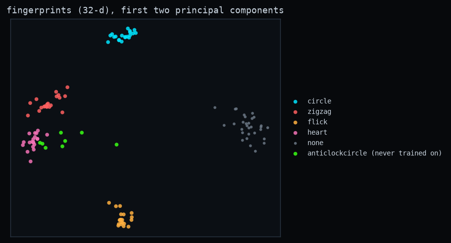
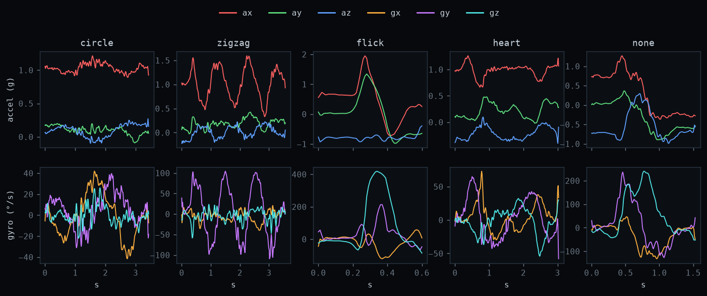
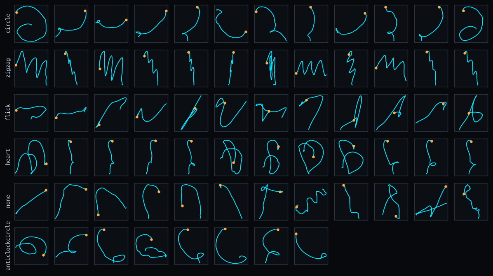
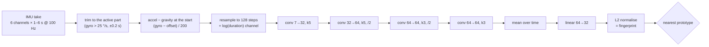
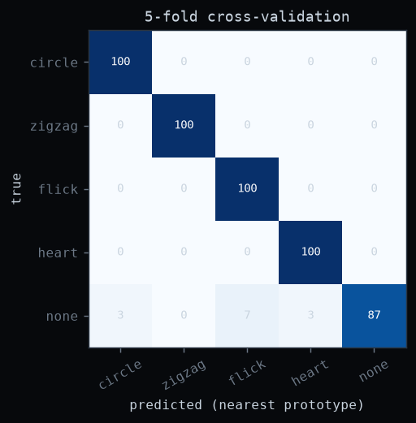
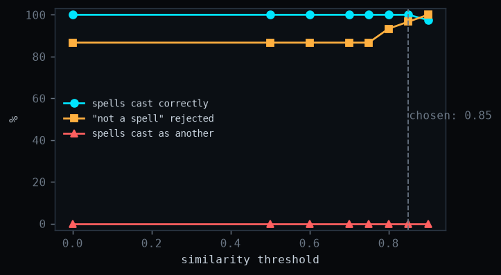
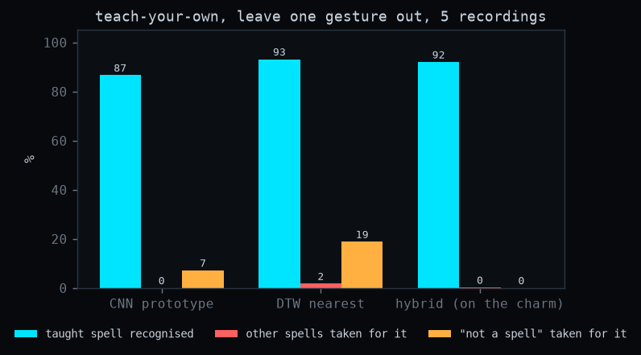

# Spells: air-gesture recognition on a bag charm

Draw a circle, a zigzag, a flick or a heart in the air with the charm in your hand, and it recognises the gesture,
plays an effect and does something: the torch comes on, the colour theme changes, Spotify skips a song, the eyes
fall in love. Teach it any gesture of your own by drawing it 5 times: it learns it on the spot, on the charm, with
no retraining and nothing sent anywhere.

Under the hood: a 1D convolutional network of **38,848 parameters** runs on the charm's ESP32-S3 in **69 ms**. It
turns 1 to 6 seconds of accelerometer and gyro data into a 32-number fingerprint. The four built-in spells are the
nearest class prototype. Spells you teach are matched by DTW against your own recordings, and the network can veto them.

| | result (cross-validated on real recordings) |
| --- | --- |
| built-in spells cast correctly | **100%** (80 of 80, none cast as another spell) |
| "not a spell" correctly rejected | **96.7%** |
| a taught spell recognised, from 5 recordings | **91.9%** |
| other spells mistaken for a taught one | **0.2%** (and 0% of "not a spell") |
| network on the charm | 69 ms, float32, matches PyTorch to 1.5 × 10⁻⁷ |



*Every recorded take's fingerprint, projected to 2D. The four spells and "not a spell" form tight, separate clusters.
`anticlockcircle` (green) is a gesture the network never saw in training, and it still lands in its own place:
that is what makes teach-your-own work.*

---

## 1. What it does

**The cast screen** (`spl` on the deck's status bar). Hold your thumb on the screen, hold still for half a second,
draw the spell in the air, hold still, let go. The screen shows the stroke as you draw it, then the network's verdict
the way a terminal would print it:

```
$ spell --cast
> circle   0.97 [################]
  heart    0.41 [######..........]
  zigzag   0.12 [#...............]
LUMOS!
-> torch  (69ms)
```

Each spell has its own effect: a ring of light opening (circle, *lumos*), lightning (zigzag, *fulmen*), streaks
flying off (flick, *accio*), a beating heart with little hearts rising (heart, *amor*), your own stroke lit up (a
spell you taught), or a puff of smoke when nothing matches (*fizzle*). Then the spell does what the spellbook says.

**The spellbook** (the website's spells tab). Choose what each spell does: torch, new colour, next song,
play/pause, eyes in love, weather, clock, pet, roll dice, claude, spotify. The choices live on the charm, so they work
without the website. Every cast the charm makes shows up in a log with its top three scores. The tab also shows a model
card with the numbers on this page.

**Teach your own.** Name a spell, pick what it does, press *teach it*, and draw it 5 times on the charm. The charm
keeps the 5 recordings and their mean fingerprint in its flash, and recognises the spell from then on. It holds up to six.

**The recorder** (the same tab, *record training data*). This is how the training data was made: a guided recording
plan, an animation of how to draw each spell, a plot of every take, and an export to JSON. It also shows what the
current network thinks of every take, which flags mislabelled ones.

## 1½. The wand

Recognising a gesture is only one way to use the motion. The spell screen has four views along its top, like tmux windows:

| view | what you do | how it works |
| --- | --- | --- |
| **cast** | cast spells, **charged up**: bigger, faster casts give bigger effects, and past 80% they are *overcharged* (a flick skips two songs, a zigzag jumps to a random colour, a heart also fills the pet with hearts) | power = the angle the charm swept (out of 90°) and its peak turning speed (out of 500 °/s), half each |
| **knob** | hold your thumb and twist the charm like a dial: Spotify volume, or the screen's brightness when nothing is playing | the gyro's Z axis (into the screen) integrated while your thumb is down: a quarter turn is 30%. The volume goes to Spotify at most every 300 ms |
| **draw** | the charm is a laser pointer: hold your thumb and draw in the air; let go to lift the pen; shake to wipe. The website mirrors the sketch, saves it as a PNG, or sends it back as the charm's photo | yaw and pitch from the gyro move a pointer (2.4 px per degree), like an air mouse; lifting the pen keeps the pointer where it is |
| **map** | the **constellation**: cast and watch your gesture's fingerprint land among the spells' clusters, live on the charm | the 32-number fingerprint projected to 2D with the PCA basis the training fitted (exported with the weights); no actions |

Knob and draw read the gyro live rather than one take at a time, so its drifting offset matters. The firmware keeps
re-measuring it whenever the charm has been still for half a second. Shake detection is off while the gyro is in
use (the accelerometer is in a different range then), so the draw view has its own: three jolts over 2.2 g within
0.7 s wipe the sketch.

## 2. The sensor

The charm has a QMI8658 6-axis IMU. For spells, the firmware switches the gyro on (it is off otherwise, to save power).
It sets accel to ±8 g and gyro to ±2048 °/s, running at 224 Hz with the chip's ~30 Hz low-pass filter. A FreeRTOS task
on the second core samples it at exactly 100 Hz, so drawing the screen can never make the timing uneven. Over the
first recordings it missed **1 sample in 35,448**.

Calibration takes (the charm lying still on each of its six faces, then turned slowly about each axis) pinned down the
frame:

| sensor axis | points to | evidence |
| --- | --- | --- |
| +X | the top of the screen | top edge down −0.95 g, bottom edge down +1.01 g |
| +Y | the right edge | left edge down +1.03 g, right edge down −0.93 g |
| +Z | into the screen, away from you | screen up −0.96 g, screen down +1.03 g |

The accelerometer is accurate to within 2%. The gyro has a resting offset of 1 to 5 °/s that **drifts from one take to
the next**. So every take starts with half a second of stillness, and the offset is measured fresh from it.

## 3. The data

Recorded with the website's recorder. Hold your thumb on the charm's screen while drawing; on release, the take goes
over Bluetooth as base64 chunks with a checksum, and a damaged take is asked for again.

| | takes | length |
| --- | --- | --- |
| circle | 20 | 2.4 to 4.0 s |
| zigzag | 20 | 2.6 to 5.0 s |
| flick | 20 | 0.3 to 1.1 s |
| heart | 20 | 3.0 to 4.7 s |
| not a spell | 30 | 0.4 to 2.7 s (holding still, tilting to read, shaking, half a circle, scribbles, pointing) |
| anticlockcircle | 8 | a custom gesture, kept out of training as a test |
| calibration | 9 | 5 to 10 s, lying still or turning slowly |



Integrating the gyro gives the direction the charm pointed while you drew. Those strokes show something important:



The strokes are only *part* of each shape: a circle comes out as a J or a U, and a zigzag as a tall squiggle. People
draw in the air mostly by **moving the arm**, which only the accelerometer sees, and partly by **turning the wrist**,
which the gyro sees. The left-to-right travel of a zigzag is nearly all arm. So the recogniser must use all six
channels, and a gyro-only approach would not have worked.

## 4. A baseline without machine learning

First a classic approach to beat: 1-nearest-neighbour with dynamic time warping (DTW) on all six channels, using k
recorded examples per class as templates (`firmware/tools/spells/baseline.py`).

| k = 5 templates | circle | zigzag | flick | heart | not a spell |
| --- | --- | --- | --- | --- | --- |
| recognised | 99.7% | 99.1% | 74.6% | 100% | **3.9%** |

DTW tells the shapes apart almost perfectly. But it cannot say **"no match"**: anything you do gets matched to some
spell, because "not a spell" has no consistent shape to match against. A threshold on the DTW distance only trades one
failure for the other (88% of spells cast and 27% rejected, or 65% cast and 100% rejected). That is the job for a
learned model.

## 5. The network



- **Input.** The take is trimmed to where the gyro is active, plus 0.2 s each side. Accel has its starting gravity
  removed; gyro has its offset removed and is scaled so 200 °/s counts like 1 g. It is resampled to 128 steps.
  Resampling throws away how long the gesture took, so a 7th channel gives it back as log(duration): a flick stays a
  flick.
- **Network.** Four 1D convolutions with batch norm and ReLU, the mean over time, then a linear layer to 32 numbers,
  scaled to length 1: the **fingerprint**. 38,848 parameters.
- **Training.** Cosine softmax (normalised fingerprints against normalised class weights, scale 16) with label smoothing.
  This trains the fingerprints to cluster by gesture, so new gestures can use them too. AdamW, one-cycle learning rate,
  160 epochs, about 10 seconds on a laptop CPU.
- **Augmentation**, since 110 takes is very little. Each sample gets small random 3D rotations (the same rotation for
  accel and gyro, as for a slightly different grip), ±20% amplitude, a smooth random time warp, jittered trim points
  and sensor noise.
- **Decision.** A class's prototype is the mean fingerprint of its takes. A take is the class whose prototype is most
  similar (cosine), and "no match" if that is *not a spell* or the similarity is under **0.85**.

 

With 5-fold cross-validation (every take tested by a network that never saw it), the spells are **100%** right and
none is confused with another. At the chosen threshold, **96.7%** of "not a spell" takes are rejected. The learned
model fixes exactly what DTW could not do.

## 6. Teach your own

The four spells are built in. The real goal is any gesture, learnt from a handful of recordings **on the charm**,
with no laptop and no retraining.

**How it was tested.** Leave one gesture out: train the network *without* that gesture, then teach it from 5
recordings like a new spell and test on the rest. Each of the four spells takes its turn, plus `anticlockcircle`
(which no network ever trained on). That gives five genuinely new gestures, tried 25 times each with different
recordings picked. Three ways of recognising the new gesture were compared:



- **CNN prototype.** The mean fingerprint of the 5 recordings competes with the built-in prototypes. Never confuses
  other spells for it, but recognises only 87%, and takes 7% of "not a spell" for it.
- **DTW nearest.** The new gesture wins if one of its 5 recordings is the nearest stored recording (5 are kept per
  built-in spell). Recognises 93%, but takes 19% of "not a spell" for it.
- **Hybrid** (what the charm runs). DTW finds the nearest recording. The new gesture wins only if that recording is
  its own, the distance is within **2×** the spread of its 5 recordings, and the network doesn't veto it (fingerprint
  similarity at least **0.3**, and not more sure it is *not a spell*). **91.9%** recognised, **0.2%** of other spells
  and **0%** of "not a spell" taken for it.

The weakest case is teaching a flick (73%). A flick is a third of a second of motion, so 5 recordings hold little to
go on.

## 7. On the charm

**Export.** `train.py` folds batch norm into the convolutions and writes everything to `firmware/LarpCharm/spells_model.h`:
the weights, the class prototypes, 5 DTW recordings per spell (the medoids of their class) and the thresholds. It
writes the same to `spells-model.js` for the website.

**The engine** (`firmware/LarpCharm/spells_engine.h`) is plain C++ with no Arduino code, so it compiles on a laptop
too. `test_engine.cpp` runs it on takes whose fingerprints PyTorch computed. `test_net.js` does the same for the
website's JS port (`spells-net.js`):

```
circle   fingerprint max diff vs pytorch 8.94e-08   class circle  0.998 ok
zigzag   fingerprint max diff vs pytorch 1.49e-07   class zigzag  0.998 ok
flick    fingerprint max diff vs pytorch 8.94e-08   class flick   0.974 ok
heart    fingerprint max diff vs pytorch 5.96e-08   class heart   0.994 ok
none     fingerprint max diff vs pytorch 1.49e-07   class none    0.949 ok
```

**Speed.** The first version took 303 ms on the charm. Two rounds of changes brought it to **69 ms**:

| change | time |
| --- | --- |
| first version: weights in flash, buffers in PSRAM, -Os (174 ms network + 137 ms DTW) | 303 ms |
| convolution loops reordered so each weight is read once, not once per time step; working memory (45 KB) in internal RAM; DTW against the built-in spells only when you have taught a spell | 124 ms |
| the engine built with -O2 instead of the sketch's -Os | **69 ms** |

**Memory.** The weights are 155 KB in flash, and the app is 1.07 MB of its 3 MB. Working memory is 45 KB of internal
RAM plus about 100 KB of PSRAM for the take and the stored recordings. Each taught spell is a file in flash (`/spl/<slot>.bin`)
holding its name, action, mean fingerprint, spread and its 5 recordings at 50 Hz.

## 7½. The constellation, on the website too

The spells tab draws the same map as the charm: the recorded takes as dots, the spells' prototypes as rings, every
cast the charm reports as a star. *Show my recorded takes* runs the website's copy of the network over the whole
dataset, which shows at a glance where the clusters are tight and which takes sit oddly.

## 8. Reproduce it

```sh
cd firmware/tools/spells
python3 look.py data.json strokes.png          # every take's stroke
python3 baseline.py data.json                  # the DTW baseline
python3 evaluate.py data.json model/eval.json  # cross-validation and teach-your-own (about 45 s)
python3 train.py data.json model/eval.json     # the final network -> spells_model.h, spells-model.js
python3 figures.py data.json                   # the figures on this page
c++ -O2 -std=c++17 -o /tmp/t test_engine.cpp && /tmp/t   # the charm's engine vs PyTorch
node test_net.js                                          # the website's engine vs PyTorch
```

`data.json` is a recording exported from the spells tab. Recordings stay out of git.

## 9. Honest limits, and what's next

- **One person, one sitting.** Every take so far is from a single sitting, so cross-validation flatters the network:
  it may have learnt that day's habits. The real test is training on one sitting and testing on another, and that
  recording is next.
- **Personal.** The network learnt how *its owner* draws. Other people, or a very different grip, will be less
  reliable for the built-in spells. Teach-your-own fixes that for any gesture.
- **Thumb-armed.** Casting needs a thumb on the screen. Always-on casting (no thumb) needs a cheap motion trigger and a
  much richer "not a spell" class from everyday life.
- **Next.** A motion simulator for arm-and-wrist drawing, tuned to these recordings, to generate hundreds of
  synthetic gesture classes, so the fingerprints generalise further. Then int8 weights (about 40 KB, and faster).
